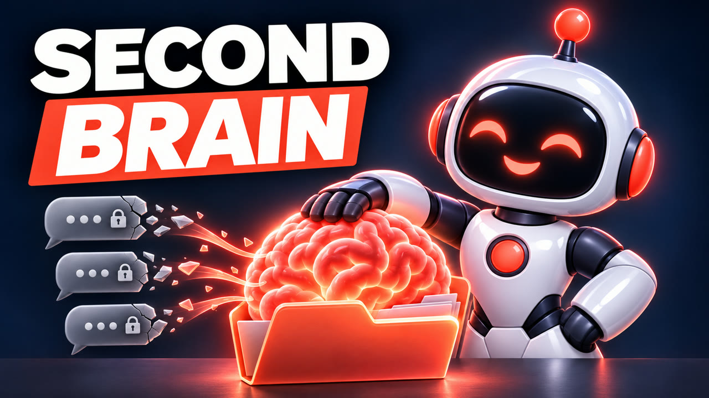

<p align="center">
  
</p>

<h1 align="center">Cerveau IA — le second brain de toutes tes IA</h1>

<p align="center">
  <b>Une seule mémoire pour Claude, ChatGPT/Codex, OpenCode et tes agents.</b><br>
  Un dossier de fichiers texte, gratuit, qui reste chez toi. En français, pour les débutants.
</p>

<p align="center">
  <a href="https://www.youtube.com/@techonnecte"></a>
  <a href="https://techonnecte.fr"></a>
  
  <a href="LICENSE"></a>
</p>

<p align="center">
  🎬 <a href="https://www.youtube.com/@techonnecte">La formation complète en vidéo</a> ·
  📖 <a href="https://techonnecte.fr">Les guides sur techonnecte.fr</a> ·
  🤝 <a href="https://techonnecte.fr/accompagnement/">Se faire accompagner</a>
</p>

---

Lundi, tu expliques ton projet à Claude. Mardi, tu passes sur ChatGPT… et tu réexpliques tout. Chaque IA a sa petite mémoire, enfermée chez elle.

**Cerveau IA** leur donne une mémoire commune : un dossier de notes, rangé par projet, que toutes tes IA lisent avant de travailler. Elles savent qui tu es, où en est chaque projet et ce qui a été décidé. **Tu changes d'IA, la mémoire reste.**

## ⚡ En 30 secondes

1. Ouvre **Claude Code** (onglet Code de l'appli Claude), **Codex** (appli ChatGPT) ou **OpenCode** (gratuit).
2. Envoie-lui :
   ```text
   Installe ces skills : https://github.com/n9ka-ai/cerveau-ia
   ```
3. Crée un dossier vide, ouvre-le dans ton IA, et dis : **« Crée mon cerveau »**.

Elle te pose 8 questions, une à la fois, te résume tout, et n'écrit rien sans ton accord.

> 💡 **Le test qui compte** : ferme tout, ouvre une nouvelle conversation (avec une autre IA si tu veux) et demande « Qu'est-ce que je dois faire cette semaine ? ». Si elle le sait, ton cerveau marche.

## 🧩 Deux skills

| Skill | Ce qu'il fait | Comment le lancer |
| --- | --- | --- |
| [`creer-cerveau`](skills/creer-cerveau/SKILL.md) | Pose quelques questions, puis monte ton cerveau au niveau choisi (1, 2 ou 3). Relance-le pour monter d'un niveau : il ne refait que ce qui manque. | « Crée mon cerveau », « passe mon cerveau au niveau 2 » |
| [`cerveau`](skills/cerveau/SKILL.md) | Les gestes du quotidien : charger un projet, sauver, ranger, rattraper les vieilles conversations, sortir un projet dans son dossier de travail, adopter un dossier existant, ingérer un document. | « Charge le projet X », « je ferme », « range le cerveau », « rattrape les sessions » |

## 🧠 Cerveau et dossier de travail

**Le cerveau**, c'est ce que tes IA *savent* : léger, que du texte, rangé par projet. **Le dossier de travail**, c'est là où elles *fabriquent* : le code d'un site, des vidéos, les gros fichiers. Il reste où il est ; la fiche du projet note son chemin, avec un bouton pour l'ouvrir.

```text
cerveau/
├── AGENTS.md        le mode d'emploi que toutes les IA lisent
├── moi.md           qui tu es, ta façon de travailler, tes « jamais »
├── index.md         le sommaire : tous les projets, où ils sont
├── journal.md       ce qui s'est passé, une ligne par action, signée
└── projets/
    ├── mon-site/
    │   └── fiche.md     état, décisions (avec leur raison), prochaines étapes,
    │                    et le bouton « 📂 Ouvrir le dossier de travail »
    └── une-idee/
        └── fiche.md     un projet sans code vit entièrement ici
```

Pas de dossier vide « pour plus tard » : chaque dossier naît avec son premier fichier. Et l'installation réunit les règles de tes IA dans **un seul fichier** (`~/.agents/AGENTS.md`), relié à Claude, Codex et OpenCode : tu écris tes règles une fois, toutes les suivent.

## 🪜 Les 3 niveaux

| Niveau | Ce que tu montes | Pour qui |
| --- | --- | --- |
| **1. Local** | Le cerveau dans un dossier de ton ordi. Toutes tes IA le lisent. | Tu débutes, tu veux que ça marche ce soir. |
| **2. Obsidian + sauvegarde** | Tu le lis comme un wiki dans [Obsidian](https://obsidian.md) (gratuit), il est sauvegardé tout seul sur GitHub, en **privé**, et tes projets lourds ont leur dossier de travail. | Tu as de vrais projets : un site, du code, des vidéos. |
| **3. Agent 24 h/24** | Le cerveau est partagé avec un agent qui tourne seul, sur un VPS ou un Raspberry Pi (par exemple [Hermes Agent](https://github.com/NousResearch/hermes-agent)). Il lit, écrit, et range le cerveau chaque nuit. | Tu veux un assistant qui travaille même ordi éteint. |

## 🗣️ Au quotidien, trois phrases

- **« Charge le projet boutique »** : en trois lignes, où on en est, la prochaine étape, la dernière décision.
- **« Je ferme »** en fin de session : la fiche est mise à jour, la décision notée *avec sa raison*, une ligne signée dans le journal.
- **« Range le cerveau »** de temps en temps : ce qui est sans risque est fait seul, le reste t'est proposé. Rien n'est jamais supprimé : tout est archivé.

Tu oublies de dire « je ferme » ? Active **le rêve** sur ce projet : à la fin de chaque session, un petit modèle relit seulement vos échanges et fait la sauvegarde à ta place (5 fois par jour au plus). Tes vieilles conversations se rattrapent aussi (« rattrape les sessions »), avec un tri gratuit sur ton PC si ta carte graphique le permet (Gemma via [Ollama](https://ollama.com)).

## 🔒 Ce qui ne va jamais dans le cerveau

- Tes clés, mots de passe et jetons : ils restent dans les variables d'environnement de ta machine.
- Le code, les vidéos, les gros fichiers : ils restent dans leur dossier de travail.
- Les méthodes que tu refais souvent : elles deviennent des **skills**, rangés dans le cerveau et reliés à toutes tes IA.

## ❓ Questions fréquentes

**Ça coûte combien ?** Les skills, Obsidian, GitHub en privé et le tri local sont gratuits. Tu paies seulement l'IA que tu utilises déjà (Claude Code est inclus dans Claude Pro, Codex dans ChatGPT), ou rien du tout avec les modèles gratuits d'OpenCode.

**Ça marche avec ChatGPT dans le navigateur ?** Non : il faut une IA qui lit et écrit tes fichiers (Claude Code, Codex, OpenCode ou un agent).

**Mes données partent où ?** Le cerveau reste chez toi, en fichiers. Ton IA reçoit seulement le passage qu'elle lit, comme n'importe quel message : rien de sensible dans une fiche.

**Sous Windows, ça bloque ?** Claude Code demande [Git pour Windows](https://git-scm.com/download/win) à la première ouverture : installe-le, puis relance l'appli.

**Et si j'arrête un jour ?** Il te reste un dossier de fichiers texte, lisibles par n'importe quoi, pour toujours.

## 🎬 La formation vidéo

Tout est montré pas à pas, du niveau 1 à l'agent qui travaille la nuit, dans une formation de 30 minutes sur la chaîne **[TECH'ONNECTÉ](https://www.youtube.com/@techonnecte)**. Le guide écrit, avec tous les liens, est sur **[techonnecte.fr](https://techonnecte.fr)**.

Besoin d'aide pour le mettre en place dans ton métier ou ton équipe ? **[Appel de 30 min offert](https://techonnecte.fr/accompagnement/)**.

## 📚 D'où ça vient

- Tiago Forte, *Building a Second Brain* (2022) : noter ce qui compte dans un endroit fiable, pour libérer sa tête.
- Andrej Karpathy, [« LLM Wiki »](https://gist.github.com/karpathy/442a6bf555914893e9891c11519de94f) : l'IA tient elle-même un wiki, avec un sommaire et un journal.

Ce dépôt reprend ces deux idées et ajoute le cerveau rangé par projet, des règles uniques pour toutes les IA, les dossiers de travail, l'adoption de projets qui existent déjà, le rattrapage des conversations et la synchronisation avec un agent distant.

## Licence

[MIT](LICENSE). Utilise, modifie, partage.

---

<p align="center">
  Fait par <a href="https://techonnecte.fr"><b>TECH'ONNECTÉ</b></a>, la tech et l'IA sans jargon · 
  <a href="https://www.youtube.com/@techonnecte">YouTube</a> · 
  <a href="https://x.com/TECHONNECTE">X</a><br>
  <i>T'es connecté ?</i>
</p>
